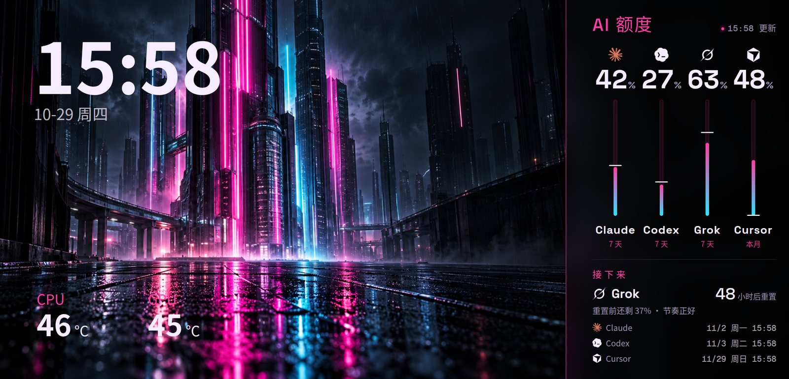
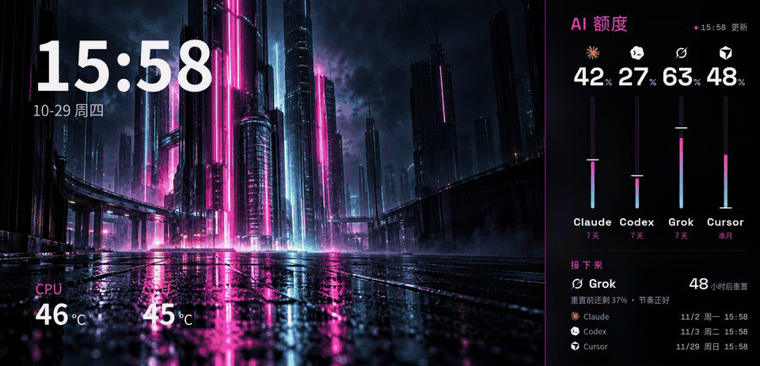
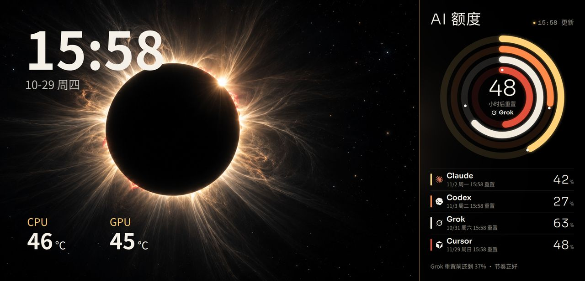
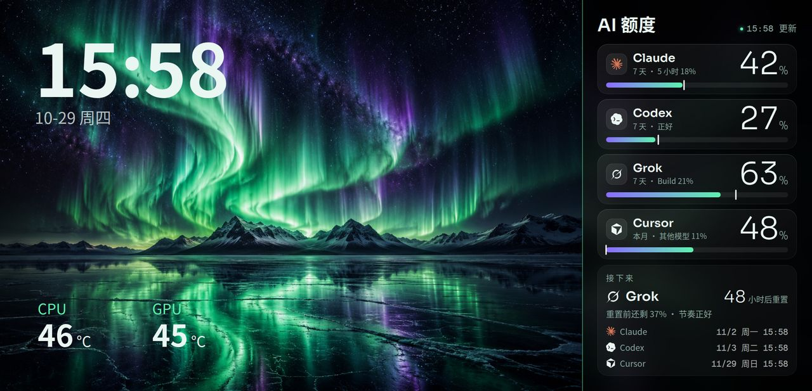
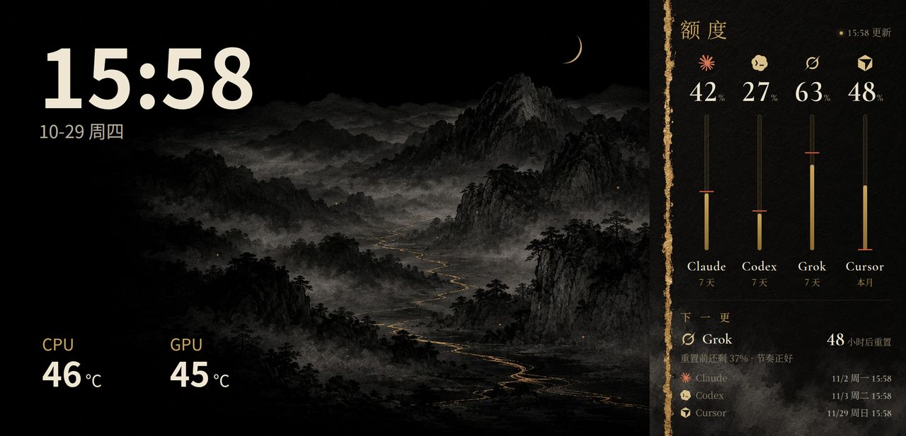
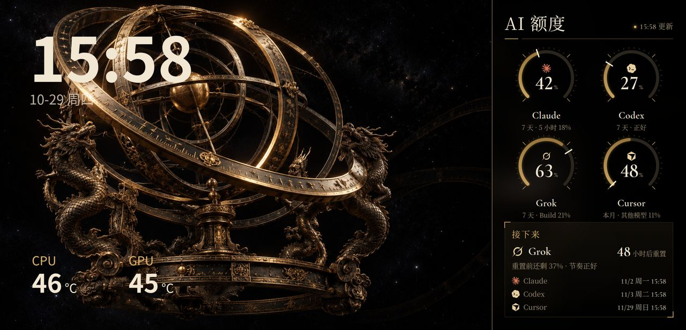
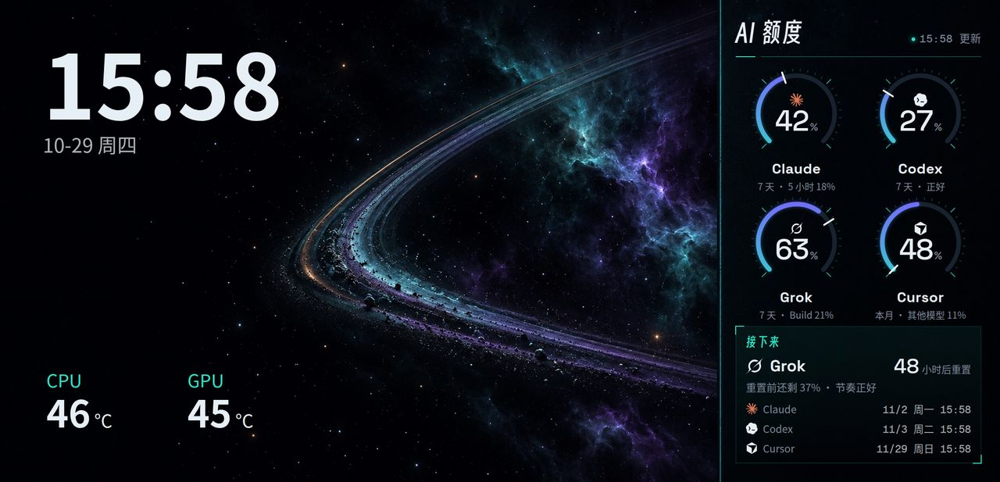
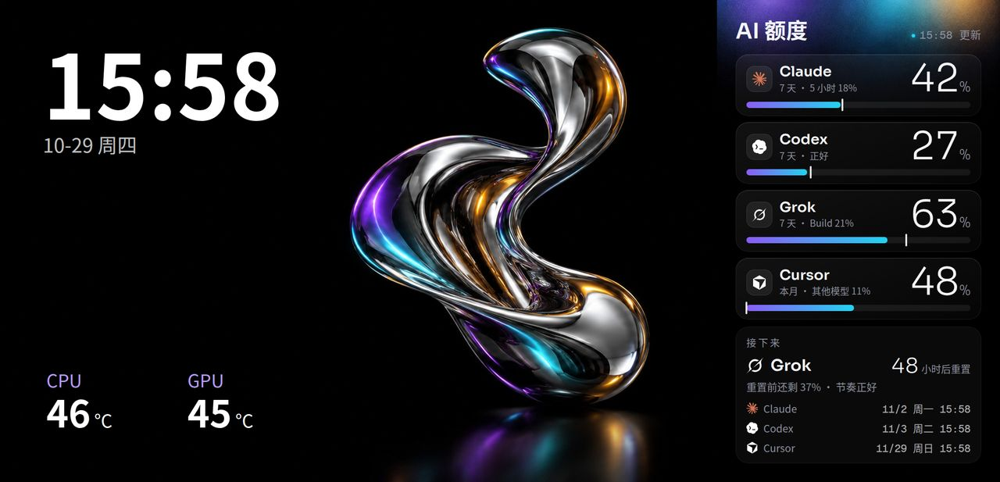
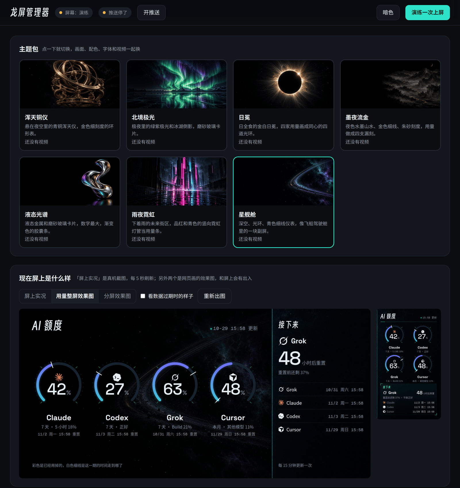
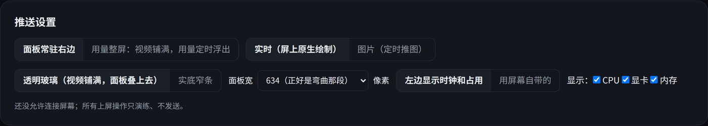

[中文](README.md)

# Ryuo Studio

A Linux stack for the 2240×1080 curved screen on the ROG RYUO IV SLC 360 ARGB: a clean-room HID driver, seven switchable themes, a quota panel for Claude, Codex, Grok, and Cursor, and a web manager that binds to localhost only. It does not use Armoury Crate or InfoHub, and it does not touch the screen's system or firmware.

[](LICENSE)
[](https://github.com/zleo-ai/ryuo-studio/stargazers)
[](https://www.python.org/downloads/)
[](#windows)

> In development. Split screen, image push, and the on-panel native overlay have been run on the maintainer's Ubuntu machine with firmware V1.0.7. That session is written up at the end of [`docs/protocol.md`](docs/protocol.md). The driver's 1.0.7 capability row still marks native HEVC as `unknown` and recommends 1920×926 H.264. The Windows installer and its unit tests exist; they have not been installed on a real Windows machine.

<p>

</p>

Split-layout preview of the Night Neon theme. The main area is on the left; the curved strip on the right holds the quotas. This frame was rendered on the host from `render/panel.html`. It is not a photo of the cooler. The percentages come from a demo snapshot. The clock, the date, and the CPU / GPU temperatures (46°C / 45°C) are placeholders baked into that preview page.

## Why this exists

ASUS ships this screen with InfoHub, on Windows. On Linux it sits on the standby clip. Ryuo Studio keeps the picture, the push, and the lighting on the host: USB HID for commands, adb for files, local OpenRGB for the lights.

Dry-run is the default. Until `device_enabled` is set in the config file, every "send to the screen" action only prints. The driver refuses `upgrade`, `transport`, and the other resources that would start a firmware update or crash the on-screen service. The official update path cannot be downgraded, so this repo does not flash firmware.

## What it does

- **Seven themes.** Starship, Eclipse, Aurora, Ink Gold, Armillary, Liquid, Night Neon. Layouts are rings, tubes, glass cards, or concentric orbits. Picking a theme in the manager swaps the picture, the colors, and the type together.
- **Quota panel.** Usage and reset time for Claude, Codex, Grok, and Cursor. In split mode the panel stays on the right strip. In full-screen mode a video fills the panel and the quotas float up on a timer.
- **Two ways onto the glass.** The default draws natively on the screen: the host sends a reading once a minute, and the countdown runs on the panel. The other path pushes a rendered PNG on a timer. Both keep the session alive with a heartbeat every second.
- **Looping video.** A local ComfyUI running MiniMax H3 can turn a theme's reference still into a clip whose first and last frames match (the repo calls these naked-eye 3D loops), then transcode it to HEVC the screen can play. Without ComfyUI you can still drop in your own files.
- **Lights follow the theme.** Local OpenRGB pushes colors to the motherboard (including its three ARGB headers), DRAM, and GPU. Modes are temporary. Nothing is saved onto the devices.
- **A localhost manager** at `http://127.0.0.1:7788`. After `desktop/install.sh`, the app shows up as 龙屏.

## Quick start

Python 3.11 or newer. None of these talk to hardware. They were run in a clean environment while this README was written.

```bash
git clone https://github.com/zleo-ai/ryuo-studio.git
cd ryuo-studio

# manager, 127.0.0.1:7788 only
python3 -I app/server.py
```

Open <http://127.0.0.1:7788>. The button reads as a dry-run apply: the screen is not allowed to connect, and the click only writes a log line.

The driver dry-run prints frames and opens nothing:

```bash
cd driver
python3 -m ryuo profiles
python3 -m ryuo --body config --media clip.mp4 --slots "CPU Temperature" "Date&Time"
python3 -m pytest
```

Light colors for the current theme, with no OpenRGB connection:

```bash
python3 -I tools/aura_sync.py --preview
```

Desktop entry and user services:

```bash
bash desktop/install.sh            # start the pusher and manager at login; also the light services if openrgb is installed
bash desktop/install.sh --no-auto  # install only; start when the icon is clicked
```

That needs a working systemd user session. HID permissions are a separate step and ask for an admin password: `bash tools/install-udev.sh`.

Before anything is actually sent to the panel:

- `adb` from the Android SDK Platform-Tools, or `RYUO_ADB`. A stock screen accepts the connection. Files go to `/sdcard/pcMedia/`.
- Set `device_enabled` to `true` in `~/.config/ryuo-studio/config.json`. The manager has no control for this.
- Chrome or Chromium, so the host can render the panel. On Windows, Edge is the fallback.
- Quota numbers from magpie, or from a JSON file named by `RYUO_QUOTA_SNAPSHOT`. With neither, the manager still opens, the preview render fails, and the program does not invent usage numbers. See below.

## What it looks like

Split-layout previews, from the same page that is pushed to the screen. The animation walks the seven themes against one demo snapshot.



| Eclipse | Aurora |
| --- | --- |
|  |  |
| Ink Gold | Armillary |
|  |  |
| Starship (default) | Liquid |
|  |  |

Those percentages are not a real bill. The demo snapshot is Claude 42% on the 7-day window (18% on the 5-hour window), Codex 27%, Grok 63% (Build 21%), Cursor 48% this month (11% on other models). The `15:58`, `10-29 周四`, CPU 46°C, and GPU 45°C on the left are constants in `render/panel.html`. They are not sensor readings from the machine that rendered the frames.

The manager, in dark mode, still in dry-run:





There was no RYUO IV attached here, so there is no live screencap. That view appears only after `device_enabled` is on and adb can see the panel. It refreshes every 5 seconds.

## How the quotas get on the screen

**Native, the default for split layout.** The screen's adb shell is root from the factory. `tools/native_panel.py` copies the program built from `overlay/`, plus fonts, icons, and backgrounds, to `/data/local/tmp/ryuo/` and starts it with `app_process`. It paints the strip the way `render/panel.html` does. The host pushes data once a minute over `adb forward` and a keepalive every 5 seconds. The countdown and the stale-data warning tick on the panel. If nothing arrives for 20 seconds, the layer hides itself. No app is installed, and the system partition is left alone. Build with `bash overlay/build.sh` (JDK 17, Android 33 `android.jar`, and d8, looked up under `~/.local/share/ryuo-toolchain/` by default). On Windows: `python overlay/build.py`.

**Pictures, used for the full-screen layout and as a fallback.** On the configured interval the host reads a quota snapshot, paints a frame in the current theme, `adb push`es it to `/sdcard/pcMedia/`, and sends one HID `config` so the screen reloads. Each round uses a new file name. Overwriting the same name does not refresh the picture.

Both paths need a heartbeat every second (CPU and GPU temperature). After about 10 seconds without one, the screen returns to standby. The pusher sends it from the background.

## Where the numbers come from

`tools/snapshot.py` asks magpie (`magpie accounts --json`) when it is installed, then fills any missing windows from a snapshot JSON. Point `RYUO_QUOTA_SNAPSHOT` at the file. The default path is `~/.local/state/aios/quota-snapshot.json`. The shape is `{"generated_at_ms", "providers":[{"windows":[{"id","used_pct","resets_at_ms", ...}]}]}`. Window ids are listed at the top of `snapshot.py`.

With neither source, the panel does not invent numbers. `snapshot.py` currently exits because it has no window to rank, and the manager's preview render fails. The manager page, theme switching, and the driver dry-run still work.

The four product icons are trademarks and are not in the git tree. `bash tools/fetch_logos.sh` downloads them locally. Without the files, the panel prints the names only.

## Adding a theme

Copy `themes/starship/`. Change `id`, `name`, `layout` (`rings`, `tubes`, `cards`, `orbits`), and `colors` in `theme.json`, replace the three backgrounds under `assets/` (full, main, strip), and edit `theme.css`. The manager lists it on the next load. To pin light colors, add `"lights": {"colors": ["#..", "#.."], "effect": "breathe"}`.

## Aura sync

`tools/aura_sync.py` talks to a local OpenRGB server at `127.0.0.1:6742` and pushes colors to the motherboard, DRAM, and GPU. The motherboard runs at 30 fps. DRAM and GPU go over SMBus at 15 fps. The primary color is the theme's title color. The secondary is `--accent2` from `theme.css`. Changing themes in the manager fades the lights over 1.5 seconds.

OpenRGB 1.0 or newer. When `openrgb` is on `PATH`, `desktop/install.sh` installs two user services: `ryuo-openrgb` (bound to 127.0.0.1) and `ryuo-lights`.

Keys in `~/.config/ryuo-studio/config.json`, all optional:

| Key | Meaning |
| --- | --- |
| `lights_enabled` | When false, devices are identified and no mode is changed |
| `lights_effect` | `flow`, `breathe`, or `static`. A theme's own `lights.effect` wins |
| `lights_brightness` | 0–100, default 70 |
| `lights_devices` | Motherboard, DRAM, and GPU by default |
| `lights_argb_leds` | How many LEDs to assume on each motherboard ARGB header. Default 60. Extra LEDs only change the length of the chase |
| `lights_on_exit` | `off` turns the lights off, `keep` holds the last frame |

Bad values are ignored and the previous good value stays. Sync uses direct color and temporary hardware modes only. It never sends OpenRGB's SAVEMODE. Devices flagged as auto-save are skipped even if listed in `lights_devices`. A Keychron keyboard is one of those: switching its mode writes the keyboard's own storage. After sleep, the sync takes the devices over again.

## Configuration

The manager writes `~/.config/ryuo-studio/config.json`.

| Key | Default | Meaning |
| --- | --- | --- |
| `theme` | `starship` | Theme id |
| `layout` | `split` | `split` keeps the panel on the right. `full` fills the screen and floats the quotas |
| `renderer` | `native` | `native` draws on the panel. `png` pushes pictures |
| `device_enabled` | `false` | `true` is what actually connects. Edit the file; the manager cannot set this |
| `push_minutes` | `15` | Picture-mode refresh |
| `full_show_seconds` / `full_hide_seconds` | 15 / 45 | How long the full-screen quotas stay up, and how long they stay hidden |
| `panel_width` | `634` | Panel width in pixels. 634 is the curved segment |
| `panel_glass` | `true` | Clear glass: video underneath, panel on top |
| `hud` / `hud_items` | on, `cpu` `gpu` `mem` | Clock and load drawn on the left |

Logs and rendered frames live in `~/.local/share/ryuo-studio/`.

## Windows

> `desktop/install_windows.ps1` and the Windows half of the unit tests are written. They have not been installed on a real Windows PC. Open an issue if you hit something.

You will want:

- Python 3.11+ from python.org, with Add to PATH.
- `adb` from the Android SDK Platform-Tools on `PATH`, or `RYUO_ADB` pointing at `adb.exe`.
- Chrome, or the system Edge.
- [LibreHardwareMonitor](https://github.com/LibreHardwareMonitor/LibreHardwareMonitor) if you want CPU temperature: enable Remote Web Server in Options (port 8085) and start it with Windows. Without it, temperature is a dash and everything else still runs. GPU temperature and load use `nvidia-smi`, NVIDIA only.
- `ffmpeg` and a local ComfyUI to generate video. Existing video files do not need either.
- Noto Serif CJK for the Armillary and Ink Gold themes. It is not in the repo. Without it, those two themes fall back to the screen's own sans serif.

```powershell
powershell -ExecutionPolicy Bypass -File desktop\install_windows.ps1
```

The script installs `hidapi`, creates scheduled tasks `RyuoStudio-pusher` and `RyuoStudio-manager` (start at logon, restart about 10 seconds after a crash, logs under `%USERPROFILE%\.local\share\ryuo-studio\`), and adds a Start Menu shortcut named 龙屏. `-NoAuto` skips the logon start. `-Uninstall` removes the tasks and the shortcut and leaves config and videos in place.

Differences from Linux:

- The screen is opened with hidapi, not hidraw, and there is no udev rule. Armoury Crate or InfoHub may hold the device; quit them first.
- Time zone is sent as an offset such as `GMT+08:00`, because Windows does not hand back an IANA name. Where daylight-saving time applies, the panel catches up within a minute of the change, because the offset is recomputed on every push.

## Safety

- The driver refuses `upgrade`, `transport`, `transported`, `turboPump`, `rotate`, and `power`.
- It does not flash firmware. The official OTA path cannot be downgraded, and failed updates are documented. See [`docs/firmware.md`](docs/firmware.md).
- Dry-run is the default. While `device_enabled` is `false`, sends are printed and no device is opened.
- Aura sync does not store a mode on the device. After reboot or power loss, each device returns to whatever it had saved.
- The panel is OLED. Firmware inserts a short burn-in clip on media change. There is no command to disable that. Longer clips mean a longer gap between those pauses.

## Layout of the repo

| Path | What it is |
| --- | --- |
| `driver/` | The `ryuo` package. HID framing, commands, a per-firmware capability table, heartbeat. The core has no dependencies. `hidapi` is only needed to open a real device. |
| `docs/` | `protocol.md` (each fact marked with the firmware it was seen on) and `firmware.md`. |
| `themes/` | Theme packs: `theme.json`, `theme.css`, three background sizes, `video-prompt.txt`. |
| `render/panel.html` | The quota page: 634×1080 strip, 2240×1080 usage screen, split preview. |
| `tools/` | Quota snapshot, headless render, video, the pusher, Aura sync, and the OS-specific layer for Linux and Windows. |
| `app/` | The manager. |
| `overlay/` | The on-screen native panel. |
| `desktop/` | Desktop entry, user services, Windows scheduled tasks. |

## Not done yet

- A lights toggle inside the manager. Today that is a config-file edit.
- Keyboards. Devices OpenRGB marks as auto-save are skipped.
- The ROG HARPE II ACE mouse. OpenRGB 1.1 does not recognize it.
- The real LED count on each RYUO fan. No public figure turned up. Extra LEDs on the header only change how long the chase looks.
- Running the installer on a real Windows machine.

## Contributing

Issues are welcome. A new theme is the smallest change: copy `themes/starship/` and the manager will pick it up.

Driver tests do not touch hardware:

```bash
cd driver && python3 -m pytest
```

Please do not add commands that start a firmware update. Protocol facts, and which firmware each one was seen on, live in `docs/protocol.md`. If something does not match a machine, change the capability table. Do not mark an unverified row as verified.

## License

Code is [MIT](LICENSE), copyright Maple. Fonts are SIL OFL 1.1; see `themes/_shared/fonts/FONTS.md`. The four AI icons are trademarks of their companies and are not shipped in the repository.

The driver is a clean-room implementation. Protocol facts come from public notes and captures. No third-party code was copied. Sources and per-item verification are in [`docs/protocol.md`](docs/protocol.md).

---

If the screen is useful on your machine, a star helps other people find it. If something does not match, open an issue and include the firmware version.
